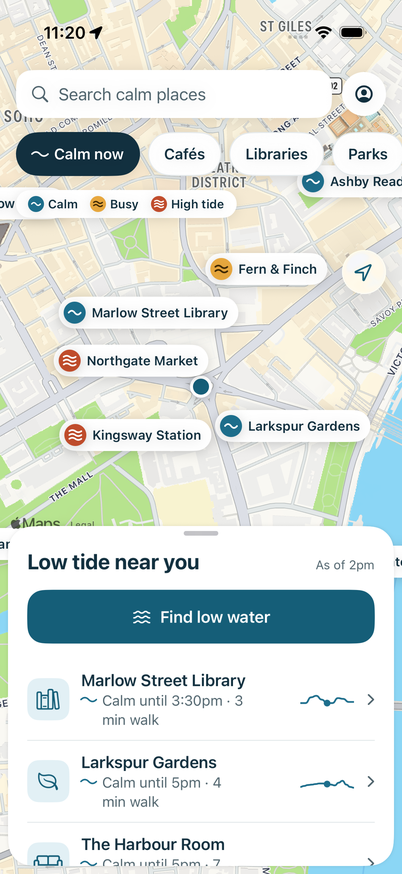
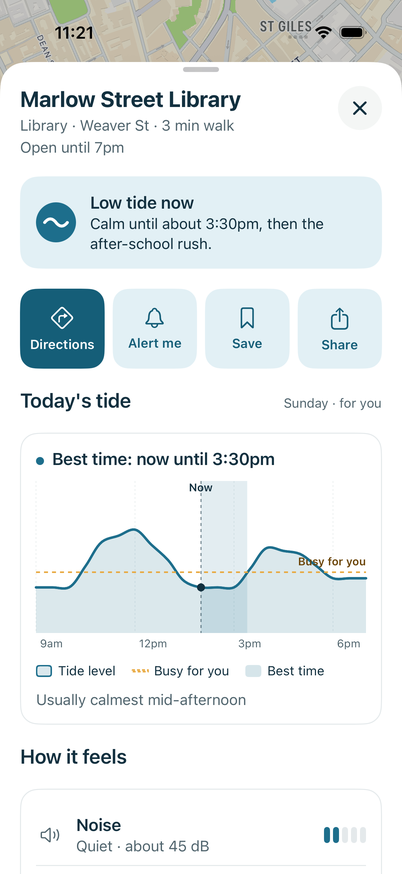
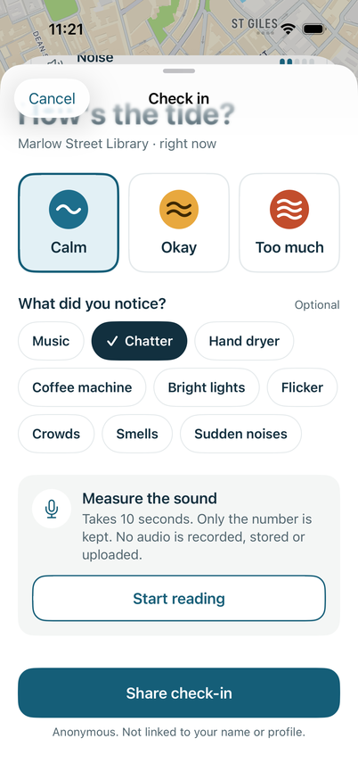
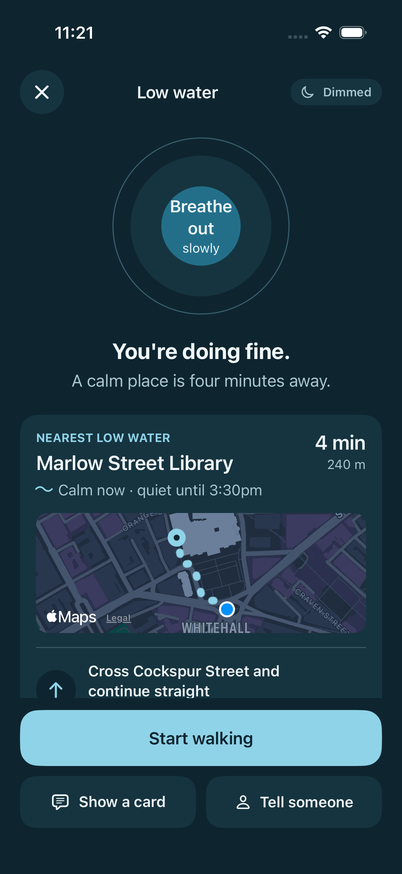

# Lowtide

Lowtide is an iPhone app for people with sensory sensitivities, such as autistic and ADHD people, people with migraines, hearing loss or anxiety. It helps them find calm places. Every place has a "tide": noise, harsh light and crowds roll in and out during the day. Lowtide forecasts **when** a place will be calm **for you**, based on your own sensory profile.

This is version 1. It uses SwiftUI, Apple Maps, Swift Charts and SwiftData, with no third-party packages, no backend, no account and no tracking. The only network requests are Apple's own walking directions.

<p>
  
  
  
  
</p>

## Run it

1. Open `Lowtide.xcodeproj` in **Xcode 16 or later**. CI builds with Xcode 26.6.
2. Choose the **Lowtide** scheme and an iOS 17+ simulator, or your iPhone.
3. To run on an iPhone, open *Signing & Capabilities* and pick your team. If Xcode says the bundle identifier (`io.github.philip-sudowicki.Lowtide`) is unavailable, change it to something unique.
4. Press Run. On first launch you set up your Tide profile, then the map opens.

Run the tests with **Product › Test** (⌘U), or from the command line:

```sh
xcrun simctl list devices available        # pick an iPhone simulator's ID
xcodebuild test -project Lowtide.xcodeproj -scheme Lowtide \
  -destination "platform=iOS Simulator,id=<SIMULATOR-ID>"
```

GitHub Actions (`.github/workflows/ios.yml`) runs the same build and tests on every push to `main` or a `claude/*` branch, and on pull requests. The run fails on any compiler, linker or asset-catalog warning.

A second job runs the UI tests in `LowtideUITests/`. They walk through every screen at 2pm with the simulator set to central London, in light mode, in dark mode and at an accessibility text size, and screenshot each step. The screenshots are uploaded as the run's `screenshots` artifact, so you can check the screens without a Mac.

### Seeing calm places at any time of day

The sample forecasts follow a real day: libraries are calm mid-afternoon, markets are busy at lunch, and most places close in the evening. To try the app at night, pin the clock to the afternoon:

- In Xcode, open **Product › Scheme › Edit Scheme › Run › Arguments** and tick `-demoTime 14:00`.
- The app then behaves as if it were 2pm and the clock runs on from there. Alert me still schedules notifications at real times.

## Where the sample data lives

- **`Lowtide/Data/places.json`** holds 10 invented places: two libraries, three cafés, a park, a market, a station, a bookshop and a quiet room. Each place has:
  - opening hours
  - 24 hourly values for each factor. Noise is stored in dB, and sudden sounds, light, crowds and smells are stored from 0 to 1.
  - trigger tags, "good to know" lines, named busy periods and an optional quiet hour
- Positions are **metre offsets** from a demo centre. The places are laid out around your first location fix, or around central London (51.5074, -0.1278) if location is denied or slow to arrive.
- Data is read through the `PlaceRepository` protocol. `LocalPlaceRepository` reads the bundled JSON. A backend can replace it later without touching the UI.
- Your profile, saved places and check-ins are stored with SwiftData on the device only.

## How the forecast works

`Lowtide/Engine/TideEngine.swift` is pure Swift and unit-tested in `LowtideTests/`.

- **Noise:** `clamp((dB − 40) / 40, 0, 1)`.
- **Personal score:** the maximum over all factors of `value × weight`. The weights are A bit = 0.5, Some = 1.0 and A lot = 1.6. The worst trigger dominates.
- **Status:** a score below 0.4 is **Calm**, below 0.7 is **Busy**, and 0.7 or more is **High tide**. A closed place has no status.
- **Between hours:** values are interpolated linearly, so changes can fall between hours. Times are shown to the nearest half hour, for example "Calm until 3:30pm".
- **Best time:** the longest calm window from now until closing. A tie goes to the earlier window.
- **Heads-up:** a trigger shows as a heads-up chip when you marked its factor Some or A lot.

## Project layout

```
Lowtide/
  App/            App entry, root view (onboarding or map), preview support
  DesignSystem/   WaveGlyph, status badges, buttons, chips, cards, meters, 44 pt segmented control
  Models/         Place, Forecast, profile, triggers, check-in options, demo clock
  Engine/         TideEngine, TideText (all user-facing tide wording), SoundLevel, map filtering
  Data/           places.json, PlaceRepository, SwiftData models and stores
  Services/       Location, MapKit directions, notifications, sound meter
  Features/       Map, Place, CheckIn, LowWater, Profile
  Assets.xcassets Colour tokens (light, dark and high-contrast variants) and a placeholder icon
LowtideTests/     Engine, wording, filtering and sample-data tests
LowtideUITests/   Screenshot walkthrough used by CI
```

## Privacy

- Location is when-in-use only and never leaves the iPhone.
- The sound meter reads microphone buffers in memory, keeps a running sum of squares and keeps only the final decibel number. No audio is written to disk, kept or sent.
- Check-ins are stored on the device. "Share check-in" saves locally in v1, and there is nothing to share with yet.

## Accessibility

- Dynamic Type text styles are used throughout. Rows, action buttons, choice cards and headers reflow at accessibility sizes, and decorative icons step aside so text keeps the full width. Map pins and the legend stop growing at the largest non-accessibility size so the map stays readable. The list below the map has no such cap.
- Every status has a glyph (1, 2 or 3 waves) as well as a colour.
- VoiceOver gets labels for pins and rows. The tide chart has a summary and an Audio Graph.
- Reduce Motion stops the breathing animation. Increase Contrast uses darker colour variants and stronger borders.
- All tap targets are at least 44 × 44 pt. The system segmented control and switches are smaller than that, so the profile uses a 44 pt segmented control and full-row toggles. VoiceOver still reads them as a standard segmented picker and switch.
- The only haptic is a light tap when a check-in is saved. The app plays no sounds, and Alert me notifications are silent.

## Where v1 differs from the brief

- **Project and builds.** The repository had no Xcode project, so `Lowtide.xcodeproj` was written by hand using Xcode 16 synchronized folders. It was developed on Linux, so every milestone was built and tested with `xcodebuild` on a GitHub Actions macOS runner instead.
- **Segmented pickers and switches** are custom 44 pt controls. The system ones are smaller than the brief's minimum tap target. VoiceOver reads them as a standard segmented picker and switch.
- **"Calm now"** filters the list in the sheet. Every pin stays on the map, as in the mockup, so you can also see where to avoid.
- **The legend** sits under the filter chips rather than above the sheet, so it stays visible at every sheet height.
- **"Updated just now"** is shown as "As of 2:14pm". The place page's footer says the forecasts are sample data instead of "built from recent check-ins", because v1 has no shared check-ins.
- **Good match for you** follows the brief's rule exactly: it appears only when the next three hours are calm.
- **Find low water** prefers places that stay calm and open for the walk plus 10 minutes. If nothing is calm it offers the quietest open place, and it never waits more than 4 seconds for Apple's walking times.
- **Times** are shown to the nearest half hour, because the forecasts are hourly. Alert me rounds *up* to the next five minutes, so it never fires before a place turns calm.
- **Extra colour tokens** were added beyond the brief's table: `surface`, `on*` colours for glyphs and button text, `highTint`, `busyGlyph`, and low-water ink and breath colours. In dark mode `calmDeep` becomes light blue with dark text, because white text on the light-mode colour would fail 4.5:1 on dark backgrounds.

